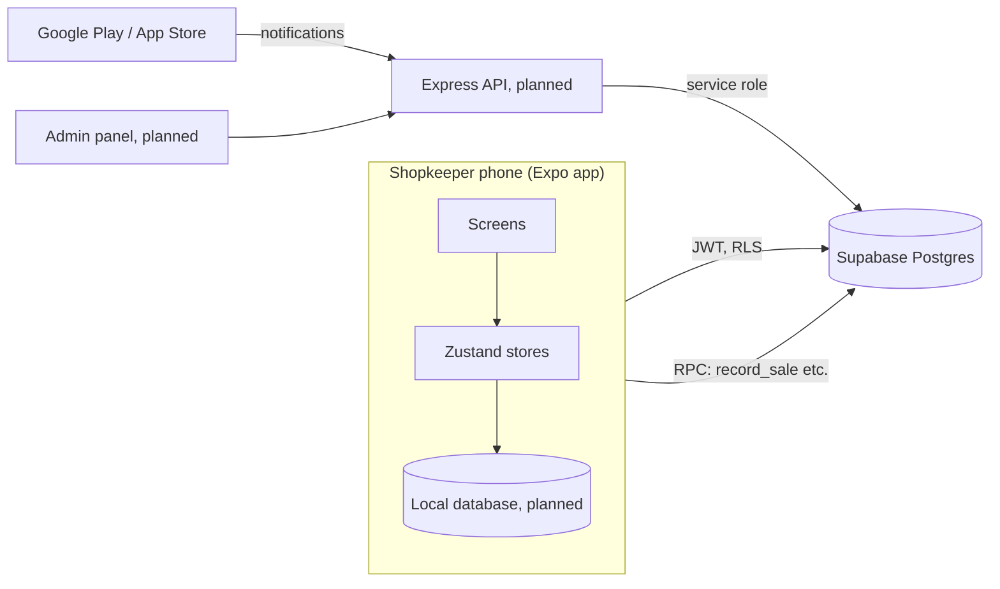

# Architecture

## Pieces

| Piece | Status | Notes |
|---|---|---|
| Mobile app (`apps/mobile`) | Foundation built | Onboarding, Home, Sell to Receipt on seed data. Expo SDK 58, expo-router, Zustand. |
| Database (`supabase/`) | Built and tested | Multi-tenant schema, RLS, entitlements, money functions. |
| Express API | Planned | Store webhooks, admin API, exports, SMS credits. Uses the service-role key. |
| Admin panel | Planned (prototype exists) | React + Vite, talks to the API. |

## Multi-tenancy

Pooled: one database, every tenant table has `shop_id`. Row level security limits each user to the shops they belong to (`memberships`). Composite foreign keys `(shop_id, parent_id)` make cross-shop references impossible. Roles: owner, manager, cashier. Details in [database.md](database.md).

## Offline-first (design)

The phone works without internet and syncs when online. Writes are idempotent by client-generated id, so an outbox can retry safely. Pulls use a monotonic `sync_seq` cursor with an overlap window. Bill numbers are device-scoped (`D2-000187`) with codes assigned by the server. The local database and sync engine are not built yet; the app currently runs on seed data in Zustand stores with the same shapes as the database.

## Money flow

Selling and khata go through server functions that recompute totals, check permissions and subscription access, and write sale, items, payments, stock and ledger in one transaction. See [database.md](database.md).

## Billing flow

The owner buys a plan with the store's purchase sheet. The store notifies the API, the API calls `apply_subscription_event`, and the database derives access (`full` or `read_only`). The app reads `get_entitlement` and caches it for up to 7 days offline. See [billing.md](billing.md).

## Cost

Shared infrastructure, work pushed to the phone (barcode scan, printing, image compression), WhatsApp via click-to-chat links, SMS sold as credits, store billing instead of a payment gateway. Scale path: bigger Postgres, read replica, partition large tables by month, dedicated database for heavy tenants.
