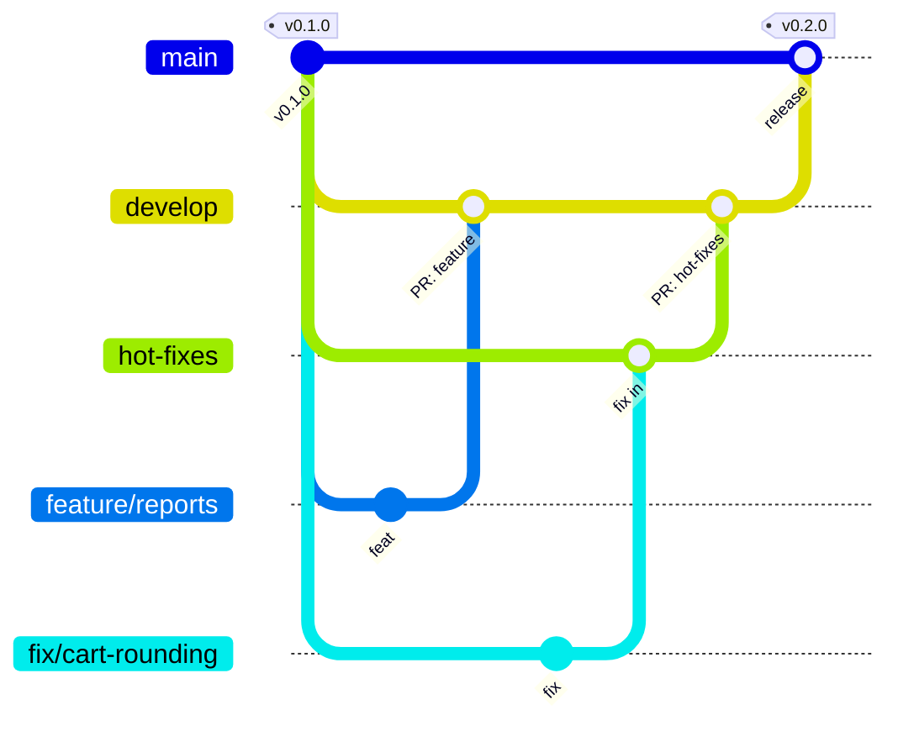

# Git workflow

Git flow with two long-lived branches and one collecting branch for fixes. The owner reviews every pull request, merges `develop` into `main`, and controls app versions.

| Branch | Lives | Comes from | Goes to | Who merges |
|---|---|---|---|---|
| `main` | Forever | `develop` only | Store releases (tags `vX.Y.Z`) | Owner |
| `develop` | Forever | `main` at the start | `main` by pull request | Owner |
| `feature/<name>` | Days | `develop` | `develop` by pull request | Owner, after review |
| `fix/<name>` | Hours to days | `develop` | `hot-fixes` | Merged into `hot-fixes` |
| `hot-fixes` | Forever | `develop` | `develop` by pull request | Owner, after review |



## Branches

Names: lowercase, hyphens, 50 characters or less.

- Features: `feature/sell-weight-entry`, `feature/khata-reminders`.
- Fixes: `fix/cart-rounding`, `fix/urdu-receipt-footer`.
- Never commit directly to `main`, `develop` or `hot-fixes`.

### A feature

```bash
git switch develop && git pull
git switch -c feature/sell-weight-entry
# work, commit, then
git push -u origin feature/sell-weight-entry
gh pr create --base develop
```

Keep `develop` current in your branch with `git rebase develop` (not merge). If a feature needs another feature that is still in review, branch from that feature and say so in the pull request. Its diff then shows both until the first one is merged.

### A fix

```bash
git switch hot-fixes && git pull
git switch -c fix/cart-rounding
# work, commit, then merge it into hot-fixes
git switch hot-fixes && git merge --no-ff fix/cart-rounding && git push
git branch -d fix/cart-rounding
```

Then open (or update) one pull request from `hot-fixes` to `develop` that carries every fix: `gh pr create --base develop --head hot-fixes`. After it is merged, bring `hot-fixes` up to date: `git switch hot-fixes && git merge --ff-only origin/develop` (or `git reset --hard origin/develop` when it holds nothing new).

A fix for something already in the stores that cannot wait for `develop`: branch `fix/<name>` from `main`, open a pull request to `main`, and the owner releases a patch version and merges `main` back into `develop`.

## Commits

[Conventional Commits](https://www.conventionalcommits.org): `type(scope): summary`, imperative, 72 characters or less.

Types: `feat`, `fix`, `docs`, `style`, `refactor`, `perf`, `test`, `build`, `ci`, `chore`, `revert`.
Scopes: `mobile`, `sell`, `khata`, `items`, `reports`, `onboarding`, `ui`, `theme`, `firebase`, `api`, `admin`, `billing`, `docs`, `git`, `ci`, `release`.
Breaking change: `feat(firebase)!: ...` plus a `BREAKING CHANGE:` footer.

The `commit-msg` hook checks the format. Enable hooks once per clone: `npm run setup` (runs `git config core.hooksPath .githooks`). The `pre-commit` hook blocks `.env` files, keystores and certificates.

## Pull requests

- Features and `hot-fixes` target `develop`. Only `develop` targets `main`.
- One concern per pull request, ideally under about 400 changed lines.
- The title is a Conventional Commit; it becomes the squash commit on `develop`.
- Fill in the template: what and why, how it was checked, screenshots for UI (English and Urdu), docs and changelog updated.
- CI must pass: typecheck, unit tests, PR title check.
- `feature/*` into `develop`: **squash** merge, delete the branch.
- `hot-fixes` into `develop` and `develop` into `main`: **merge commit**, keep the branch.

Recommended GitHub settings: protect `main`, `develop` and `hot-fixes` (require a pull request and the CI checks, block force pushes and deletion), and make `develop` the default branch so new pull requests target it.

## Worktrees

Work on two branches at once without stashing: one folder per branch, all sharing one repository.

```
E:/POS-mobile-app                      the branch you are on now
E:/POS-mobile-app-worktrees/<name>     one folder per extra branch
```

- New: `git worktree add ../POS-mobile-app-worktrees/<name> -b feature/<name> develop`
- Each worktree needs its own `npm install` in `apps/mobile` and its own `apps/mobile/.env` (copy it; it is git-ignored).
- A branch can be checked out in only one worktree at a time.
- When the branch is merged: `git worktree remove ../POS-mobile-app-worktrees/<name>` and `git branch -d feature/<name>`.
- `git worktree list` shows them all.

## Releases (owner)

The owner decides when and which version. See [versioning.md](versioning.md).

1. On `develop`, up to date, CI green: `npm run bump -- minor` (or `patch`, `major`, an exact version). It updates the version files and the changelog heading.
2. Commit `chore(release): v0.2.0` through a pull request to `develop`.
3. Pull request `develop` into `main`; merge it.
4. Tag on `main`: `git tag -a v0.2.0 -m "v0.2.0" && git push origin v0.2.0`.
5. Later: tags trigger production app builds (EAS) and the production deploy of Firestore rules and functions.

## Firestore rules and functions in branches

Rules and Cloud Functions deploy from `main` only. Data shapes change by adding fields, never by reinterpreting old ones (RULES.md #5), so two branches can change them side by side; resolve conflicts in `firebase/firestore.rules` by keeping both sets of rules and their tests.

## Environments (planned)

Development Firebase project for `develop` and pull requests, production for tags on `main`. Not set up yet.

## AI agents

Same rules. An agent works on `feature/*` or `fix/*` branches only, opens pull requests to `develop` (or merges fixes into `hot-fixes`), never merges into `develop` or `main`, never bumps the version or tags, never force-pushes and never skips hooks. It commits, pushes or opens a pull request only when asked.
