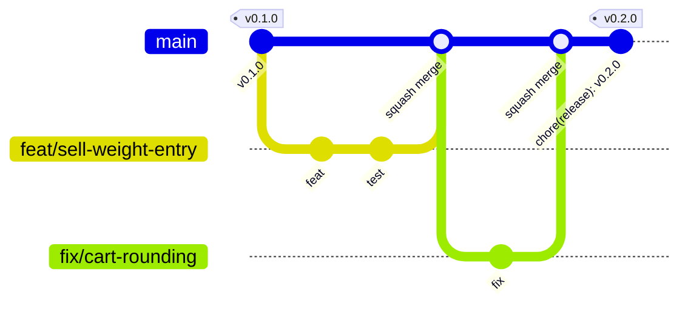

# Git workflow

Trunk-based with short-lived branches. One long-lived branch: `main`. It is always releasable. Releases are tags on `main`.

Why not git-flow: a small team shipping a mobile app and a database does not need a `develop` branch. Store review adds delay, but the app can already be rolled out gradually and the backend is backward compatible (see [versioning.md](versioning.md)), so release branches are only for patching an old release.

## Branches

Format: `<type>/<scope>-<short-description>`, lowercase, hyphens, 50 characters or less.

| Type | For | Example |
|---|---|---|
| `feat` | New behavior | `feat/sell-weight-entry` |
| `fix` | Bug fix | `fix/cart-rounding` |
| `db` | Migrations, policies, functions | `db/return-limits` |
| `refactor` | No behavior change | `refactor/ui-kit-row` |
| `docs` | Docs only | `docs/billing-flow` |
| `test`, `chore`, `ci`, `build` | As named | `chore/upgrade-expo` |
| `release/x.y` | Patching an old release only | `release/0.2` |

Start from an up-to-date `main`: `git switch main && git pull && git switch -c feat/sell-weight-entry`. Keep a branch alive for days, not weeks. Rebase on `main` instead of merging `main` into it.

## Commits

[Conventional Commits](https://www.conventionalcommits.org): `type(scope): summary`, imperative, 72 characters or less.

Types: `feat`, `fix`, `docs`, `style`, `refactor`, `perf`, `test`, `build`, `ci`, `chore`, `revert`.
Scopes: `mobile`, `sell`, `khata`, `items`, `onboarding`, `ui`, `theme`, `db`, `api`, `admin`, `billing`, `docs`, `ci`, `release`.
Breaking change: `feat(db)!: ...` plus a `BREAKING CHANGE:` footer.

Examples: `feat(sell): add weight entry`, `fix(db): reject duplicate reversal`, `docs(billing): note trial rules`.

The `commit-msg` hook checks the format. Enable hooks once per clone: `npm run setup` (runs `git config core.hooksPath .githooks`). The `pre-commit` hook blocks `.env` files, keystores and certificates.

## Pull requests

- One concern per PR, ideally under about 400 changed lines.
- The PR title is a Conventional Commit; it becomes the squash commit.
- Fill in the template: what and why, how it was checked, screenshots for UI (English and Urdu), docs and changelog updated.
- CI must pass: typecheck, unit tests, database tests, PR title check.
- Merge with **squash**, delete the branch. History on `main` stays linear: one commit per change.

Recommended GitHub settings for `main`: require a pull request, require the CI checks, require linear history, block force pushes and deletion, restrict direct pushes.

## Migrations in branches

Migration files are named by timestamp. If two branches add migrations, the later timestamp runs later. If a rebase leaves your migration older than one already on `main`, rename your file with a new timestamp. Never edit a migration that has landed on `main`; add a new one.

## Releases

1. On `main`, up to date, CI green: `npm run bump -- minor` (or `patch`, `major`, or an exact version). It updates the version files and the changelog heading.
2. Commit: `chore(release): v0.2.0`.
3. Tag: `git tag -a v0.2.0 -m "v0.2.0"` and push the tag.
4. Later: tags trigger production app builds (EAS) and the production migration run.

## Hotfixes

Normal case: `fix/…` branch from `main`, merge, release a patch. If `main` holds unreleased work that must not ship: `git switch -c release/0.2 v0.2.0`, cherry-pick the fix, bump to `0.2.1`, tag, and merge the fix back to `main`.

## Environments (planned)

Preview or development Supabase project for pull requests, staging for `main`, production for tags. Not set up yet.

## AI agents

Same rules. An agent does not commit, push or open a pull request unless asked, never force-pushes, never skips hooks.
